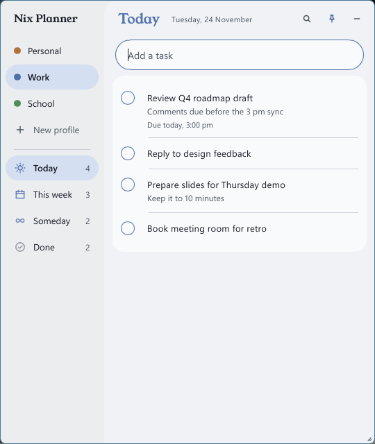
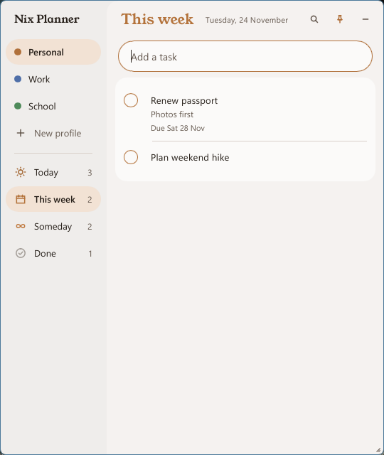
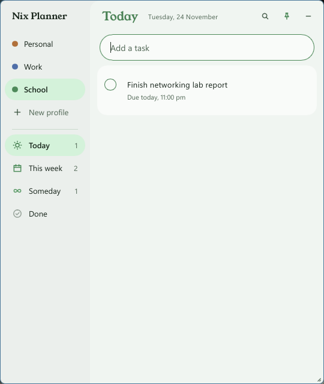

<div align="center">

# Nix Planner

**A small, calm task planner for Windows.**

One native `.exe`. No browser engine, no runtime, no installer.

[](https://github.com/VictorBashayi/nix-planner/releases/latest)

[](LICENSE)




</div>

Nix Planner keeps your tasks in four buckets (Today, This week, Someday and Done) and stays
out of the way. It is written in Rust with [Slint](https://slint.dev) and renders in software,
so it idles at about 0% CPU and uses roughly 5 MB of private memory.

<p align="center">
  
  &nbsp;
  
  <br>
  <sub>Each profile has its own colour, which tints the whole window.</sub>
</p>

## Download

Get `nix-planner.exe` from the [latest release](https://github.com/VictorBashayi/nix-planner/releases/latest)
and run it. You can keep it anywhere, for example `%LOCALAPPDATA%\Programs\Nix Planner\`. To start it
when you sign in, put a shortcut to it in your Startup folder (`Win+R`, then `shell:startup`).

> [!NOTE]
> The exe isn't code-signed yet, so Windows SmartScreen may warn you the first time you run it.
> Choose **More info**, then **Run anyway**.

## Features

- **Buckets:** Today, This week, Someday and Done, each its own page in the sidebar (`Ctrl+1/2/3/4`).
- **Profiles:** separate sets of tasks, such as Personal, Work and School. Switch in the sidebar or press `Ctrl+Tab` for the next; "New profile" adds one, and right-clicking a profile renames, recolours or deletes it. Each profile has its own colour, which tints the whole window. Drag a task onto a profile (or use its "…" menu) to send it there. Deleting a profile deletes its tasks, after a second click to confirm. Reminders fire for every profile.
- **Quick add:** type in the box at the top; the task goes into the page you're on.
- **Editing:** click a title or note to edit it (the "…" menu adds a note to a task without one). `Enter` saves, `Esc` reverts, and an empty title deletes the task.
- **Due dates and reminders:** type a date or time with the task, such as `Call mum tomorrow at 3pm`. The date picks the bucket, and a Windows notification reminds you when it's due.
- **Search:** `Ctrl+F` or the magnifier filters every bucket by title and note. `Esc` closes it.
- **Drag and drop:** press, hold briefly, then drag a task to reorder it, or drop it on a bucket in the sidebar to move it there.
- **Completing:** checking a task sends it to Done. Unchecking it puts it back where it was.
- **Clear completed:** "Clear" at the top of the Done page deletes every finished task. Click it twice to confirm.
- **Undo and redo:** with the add box empty, `Ctrl+Z` undoes the last change and `Ctrl+Y` or `Ctrl+Shift+Z` redoes it. After a delete or clear, an Undo button shows for a few seconds. The last 50 steps are kept until you quit.
- **Light and dark:** follows Windows' app mode.
- **Tray app:** closing the window hides it to the tray. `Alt+P` or a tray click toggles it.
- **Pin:** the pin button keeps the window on top.

### Desktop widget

A transparent card on the desktop shows today's open tasks for the profile on show. Tick one to complete it.

- Win+D (Show desktop) leaves it in place.
- It stays below your other windows and out of Alt+Tab, and Windows can't snap or maximise it.
- Only the header, the task rows and the grip take clicks. The rest of its rectangle is click-through, so desktop icons under it still work.
- The text switches between light and dark to stay readable on your wallpaper.
- Drag the header to move it, use the corner grip to resize it, and double-click the header to open the planner.
- It remembers its position and size.
- "Show or hide widget" in the tray menu toggles it.

## Data

Tasks are saved to `%APPDATA%\nix-planner\planner-tasks.json`. Writes are debounced and
atomic, and an unreadable file is backed up rather than overwritten.

## Building

You need Rust with the GNU toolchain (`x86_64-pc-windows-gnu`) and
[WinLibs MinGW-w64](https://winlibs.com/) on `PATH`. The toolchain's bundled `dlltool` can't
find `as` without it.

```sh
cargo test
cargo run                # debug build
cargo build --release    # target/release/nix-planner.exe
```

Only one copy runs at a time, so quit the installed app before running a dev build.

See [docs/design.md](docs/design.md) for behaviour, data format and visual design notes.

## Credits

Young Serif font by [The Young Serif Project Authors](https://github.com/noirblancrouge/YoungSerif), under the SIL Open Font License (`ui/fonts/OFL.txt`).

Built with [Slint](https://slint.dev), used under the Slint Royalty-free Desktop, Mobile, and Web Applications License.

[](https://slint.dev)

## Licence

Nix Planner's own code is under the [MIT License](LICENSE). The font and Slint keep their own licences, as noted above.
